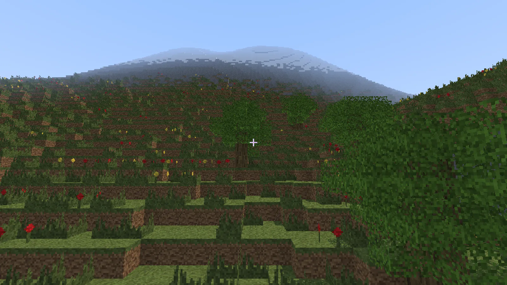
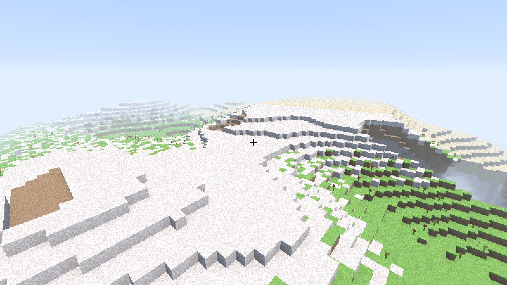
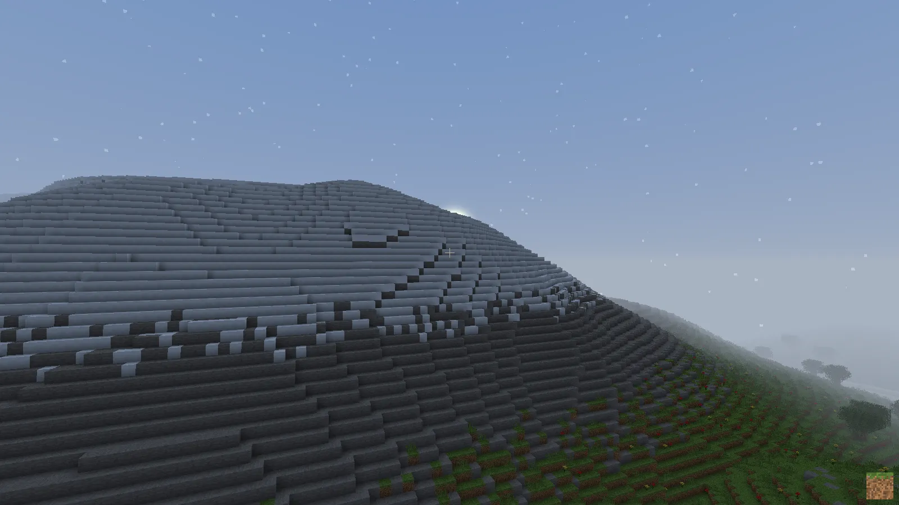
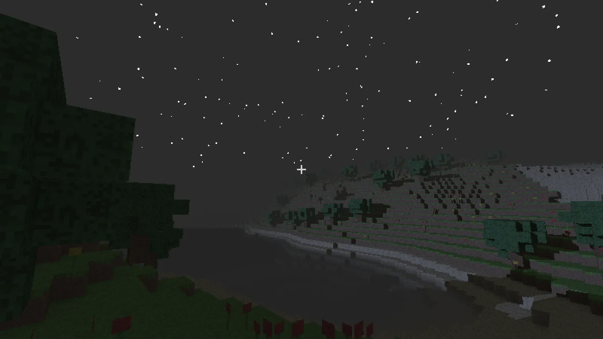
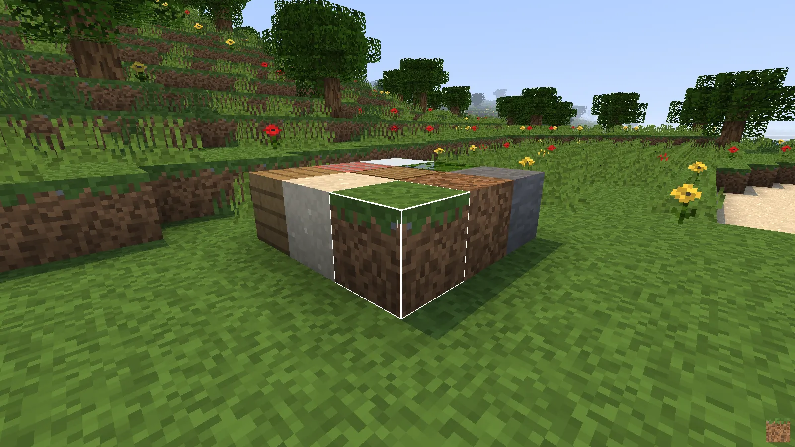
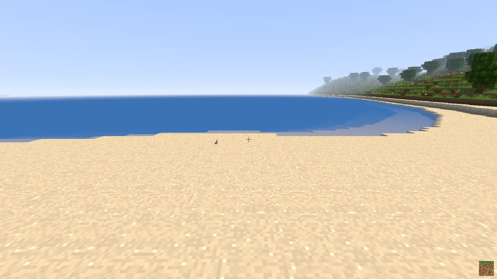
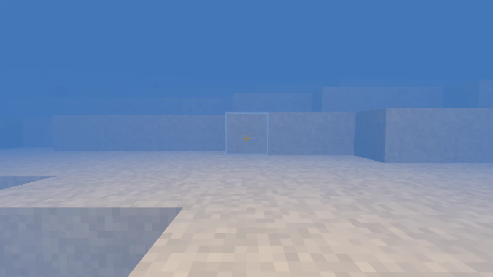

# 4k-minecraft

A remake of Notch's 2009 Minecraft 4k as one self-extracting HTML file of at most 4096 bytes, rendered with WebGPU. The page, `dist/index.html`, is 4073 bytes.

## Screenshots



*The spawn at noon: a lake with a beach, trees, flowers and hills in the distance.*

<table>
<tr>
<td width="50%"><br><sub>Snow and grey stone on a grassy slope.</sub></td>
<td width="50%"><br><sub>Sunset: a low sun, long shadows and the first stars.</sub></td>
</tr>
<tr>
<td width="50%"><br><sub>Night: stars over the terrain, with the crosshair.</sub></td>
<td width="50%"><br><sub>The nine placeable blocks and their 16x16 procedural textures.</sub></td>
</tr>
<tr>
<td width="50%"><br><sub>A flower meadow seen from the ground.</sub></td>
<td width="50%"><br><sub>Underwater: the sandy bottom of a lake behind the blue tint.</sub></td>
</tr>
</table>

`bun run screenshots` regenerates them.

## What it is

Notch's entry for the Java 4K contest, released in December 2009, was 2581 bytes: a 64x64x63 world drawn by a CPU raycaster at about 214x120 pixels (160x120 in its first version), with only grass to place. This version keeps the idea and moves world generation and rendering to the GPU. The world is 512x512x64 and generated by a compute shader at load, a fragment shader marches a ray through the voxels for every pixel, and the whole game, shaders included, fits in a single HTML file under 4 KB.

## Features

- World: 512x512x64 cells that wrap around on x and z. Value-noise terrain, lakes at sea level with beaches, deserts, snow on the peaks, caves, trees, flowers on the grass and coal, iron and diamond ores.
- Physics: a 0.6 x 1.8 box with gravity, jumping, wall and ceiling collisions and swimming. One block can be climbed by jumping, and Space in water jumps out of the lake onto the shore.
- Rendering: voxel ray marching per pixel at half the window resolution, procedural 16x16 textures, ambient occlusion, sun shadows, a day and night cycle with stars, distance fog, underwater tint, a block outline and a crosshair.
- Blocks: break the block you aim at (reach of 6 blocks, a flower above it goes with it) and place the selected block in front of it. A flower can be broken directly or replaced by a block.

## Controls

| Input | Action |
|---|---|
| Click | Lock the pointer |
| Mouse | Look around |
| W A S D | Walk, read from `e.code` so the same physical keys work as Z Q S D on AZERTY |
| Space | Jump, or swim up and out of water |
| Left click | Break the targeted block |
| Right click | Place the selected block |
| 1 to 9 | Select the block: grass, dirt, stone, sand, log, leaves, planks, bricks, snow |

## Browser support

Chrome on Windows with WebGPU, opening the file straight from `file://`, is the tested target. Edge shares its engine but is untested. The page saves bytes with recent WebGPU shorthands (a `GPUBuffer` passed directly as a binding resource, the canvas texture passed as the render target view, the size-only `copyBufferToBuffer`), so browsers that do not implement them yet cannot run it. Pointer lock asks for raw mouse input and falls back to a plain lock where raw input is not available.

## How the 4 KB packing works

**Characters as bytes.** The page declares `<meta charset=l1>`, which browsers decode as windows-1252, so every byte of the compressed stream reads back as exactly one character. The stream sits in an HTML comment inside `<canvas id=c>`, whose fallback content never renders, and the decoder reads it as `c.firstChild`. NUL and the bytes 0x80 to 0x9F come back as other characters and are mapped back through a lookup string. CR is the one byte the HTML parser rewrites (to LF), so it is escaped as `E1` and the escape byte itself as `E0`, where `E` is the rarest safe byte of the stream. Streams that would close the comment early are rejected.

**DecompressionStream.** The stream is raw deflate, inflated in the browser with `DecompressionStream('deflate-raw')` and evaluated, so the page carries no decompressor and no zlib header or checksum.

**Zopfli and libdeflate.** The deflate stream comes from zopfli (run in a pool of workers, one per core) and libdeflate with several settings. Each candidate is packed into a full page and the smallest page wins, which is not always the shortest raw stream because the escapes change the size.

**Minifier variants.** The bundle is minified by a set of terser option variants, by Bun's minifier and by both chained. Every variant is ranked by its libdeflate length and the best two are packed for real. `bun run build --rank` prints the ranking.

**WGSL minify, rename and constants.** The shader is stripped of comments and every optional space, its declared multi-letter names are renamed to the shortest free ones (most used first), and the numeric exports of `src/world.ts` (`SIZE`, `HEIGHT`, `WATER`, ...) are substituted into it by name, so game and shader share one set of constants.

## Development

```powershell
bun install
bun run build         # dist/index.html, prints the size and fails above 4096 B (--rank lists the minifier variants, --dev writes dist/dev.html)
bun run dev           # Bun.serve dev server with HMR on http://localhost:3000, unminified, DEV hooks on
bun run check         # tsc
bun run test          # unit tests and the e2e render of dist/index.html
bun run test:e2e      # build, then the e2e render alone
bun run test:fuzz     # packer fuzz, about 15 s
bun run verify        # build, open dist/index.html in headless Chrome from file://, fail on console errors, screenshot
bun run screenshots   # build --dev, then write screenshots/<name>.webp for the README gallery (view names as arguments render only those)
bun scripts/webview.ts dist/dev.html --eval "dbg.bench()" --keys "w:500,space:100" --shot out.png
```

`dist/dev.html` comes from `bun run build --dev` or `bun run verify --dev`. `verify` forwards the CLI of `scripts/webview.ts`: `--dev` (open `dist/dev.html`), `--eval` (run an expression in the page and print the result), `--keys` (hold keys in order, `"w:500,space:100"`) and `--shot` (screenshot path).

The DEV build exposes `dbg` on `globalThis`:

| Hook | What it is |
|---|---|
| `dbg.P` | Feet position `[x, y, z]`, writable |
| `dbg.A` | View angles `[yaw, pitch]`, writable |
| `dbg.V` | The world, one byte per cell (index `x + z * 512 + y * 262144`) |
| `dbg.v` | Velocity `[x, y, z]` |
| `dbg.act(button)` | Break (0) or place (2) at the target |
| `dbg.bench(n)` | Mean milliseconds of `n` draws, 100 by default |
| `dbg.time(seconds)` | Sets the clock of the sun, so day and night can be picked |
| `dbg.select(block)` | Sets the block placed by the right click |
