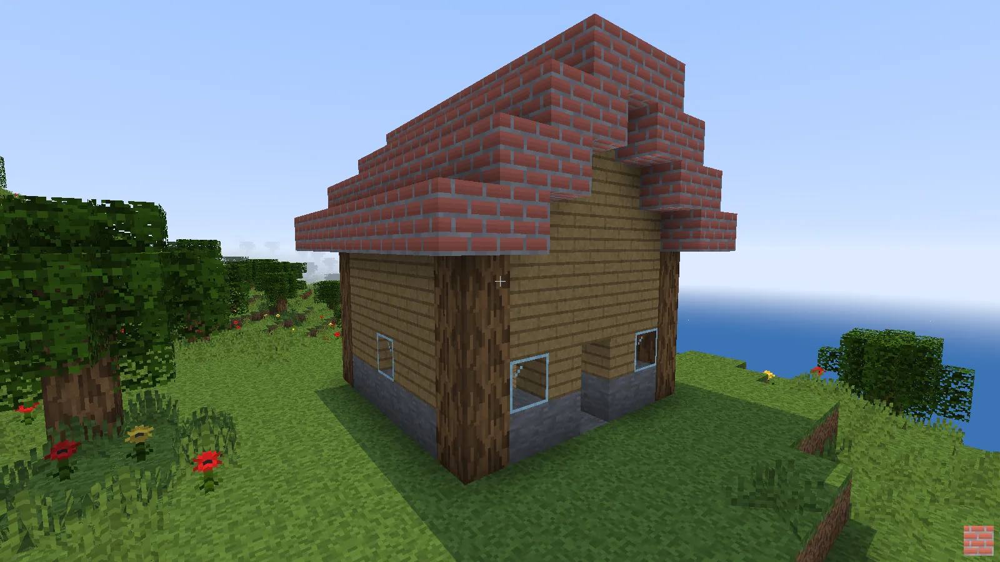

# 4k-minecraft

A remake of Notch's 2009 Minecraft 4k as one self-extracting HTML file of at most 4096 bytes, rendered with WebGPU. The page, `dist/index.html`, is 4085 of 4096 bytes, a figure `bun run build` keeps in sync here, in `dist/about.html` and in `dist/llms.txt`.

Play at https://4k-minecraft.ayfri.com.

## Screenshots


*Near the spawn at noon: grass terraces with flowers, tufts and trees below the snowy massif.*

<table>
<tr>
<td width="50%"><br><sub>The snowy massif from the air: a snow cap above bare stone terraces.</sub></td>
<td width="50%"><br><sub>Sunset over the big lake: a low sun and the first stars.</sub></td>
</tr>
<tr>
<td width="50%"><br><sub>Night: stars over the terrain, with the crosshair.</sub></td>
<td width="50%"><br><sub>The blocks on keys 1 to 9 and their 16x16 procedural textures.</sub></td>
</tr>
<tr>
<td width="50%"><br><sub>A meadow of flowers and short grass tufts, with the lake on the horizon.</sub></td>
<td width="50%"><br><sub>Underwater: the sandy bottom of a lake behind the blue tint.</sub></td>
</tr>
<tr>
<td colspan="2"><br><sub>A house the bot builds through the player's own controls: stone foundation, plank walls, log corners, glass windows and a brick gable roof.</sub></td>
</tr>
</table>

`bun run screenshots` regenerates them.

## What it is

Notch's entry for the Java 4K contest, released in December 2009, was 2581 bytes: a 64x64x63 world drawn by a CPU raycaster at about 214x120 pixels (160x120 in its first version), with only grass to place. This version keeps the idea and moves world generation and rendering to the GPU. The world is 1024x1024x128 (128 MiB, one byte per cell) and generated by a compute shader at load, the same compute shader then marches a ray through the voxels for every pixel and writes it straight into the canvas texture, and the whole game, shaders included, fits in a single HTML file under 4 KB.

## Features

- World: 1024x1024x128 cells that wrap around on x and z. Value-noise terrain with biomes hundreds of blocks wide: a big lake and smaller ones at sea level (y 44) with beaches, large deserts, plains and forests, and a mountain massif up to y 124 with bare stone above about y 80 and snow above about y 95. Caves, trees, red and yellow flowers and short grass tufts on the grass, and coal, iron and diamond ores by depth. The player spawns above the west shore of the big lake and drops onto it.
- Physics: a 0.6 x 1.8 box with gravity, jumping, wall and ceiling collisions and swimming. One block can be climbed by jumping. In water, walking slows down, Space swims up slowly, and against a block it jumps out of the lake onto the shore.
- Rendering: voxel ray marching per pixel at the full window resolution, procedural 16x16 textures with colours and patterns matched to the vanilla block textures, ambient occlusion, sun shadows, see-through leaves that let light and shadows through like the vanilla fancy leaves, glass that only shows its frame and a glint, flowers and tufts drawn as X sprites on the two diagonal planes of their cell, a day and night cycle with stars and a dark moonless night, distance fog that also covers far water, underwater tint, a box outline on the targeted block or plant, a crosshair and a 48 px preview of the selected block in the bottom-right corner (its 16x16 texture scaled 3x, 10 px from the edges, with the transparent texels of plants, leaves and glass left out as in the world).
- Blocks: break the block you aim at (reach of 6 blocks, a plant above it goes with it) and place the selected block in front of it. A flower or a tuft can be broken directly or replaced by a block.

## Controls

| Input | Action |
|---|---|
| Click | Lock the pointer |
| Mouse | Look around |
| W A S D | Walk, read from `e.code` so the same physical keys work as Z Q S D on AZERTY |
| Left Shift | Sprint: with W held, forward speed is 1.3x |
| Space | Jump, swim up in water, or jump out of water against a block |
| Left or middle click | Break the targeted block |
| Right click | Place the selected block |
| 1 to 9, 0 | Select the block: grass, dirt, stone, sand, log, leaves, planks, bricks, snow, glass |
| Mouse wheel | Cycle the selected block through everything placeable: the red flower, the yellow flower, the tuft, the ten blocks above, then coal, iron and diamond |

## Browser support

Chrome on Windows with WebGPU, opening the file straight from `file://`, is the tested target. The page saves bytes with recent WebGPU features: a `GPUBuffer` and the canvas `GPUTexture` passed directly as binding resources, the canvas configured as an `rgba8unorm` storage texture written by the compute shader, and the uniforms passed as immediates with `setImmediates` and `var<immediate>` without a `requires` directive (the size-only `copyBufferToBuffer` is DEV only). Pointer lock asks for raw mouse input and falls back to a plain lock where raw input is not available.

| Browser | Runs | Why |
|---|---|---|
| Chrome 150+ on Windows | yes | tested on Chrome 155 without any flag |
| Edge 150+, Chrome 150+ on Linux and ChromeOS | untested | same engine, WebGPU on Linux depends on the GPU ([MDN compat data](https://github.com/mdn/browser-compat-data/blob/main/api/GPUCanvasContext.json)) |
| Chrome on macOS | no | `rgba8unorm` canvases are not supported on macOS ([crbug 40823053](https://crbug.com/40823053)) |
| Firefox 158 | no | no immediates: `setImmediates` is undefined and naga rejects `var<immediate>` (`Capability IMMEDIATES is not supported`). Tested on Windows: WebGPU, the 128 MiB buffer, the `rgba8unorm` storage canvas, direct `GPUBuffer` and `GPUTexture` bindings and `deflate-raw` all work |
| Safari 26 | no | no immediates ([MDN compat data](https://github.com/mdn/browser-compat-data/blob/main/api/GPUComputePassEncoder.json)) |
| Phones and tablets | no | the controls need a keyboard and a mouse |

Immediates ship in Chrome 150 ([New in WebGPU 149-150](https://developer.chrome.com/blog/new-in-webgpu-149-150)). A uniform buffer instead would let Firefox run the page on Windows, at the cost of more bytes than the page has left.

## How the 4 KB packing works

**Characters as bytes.** The page is `<meta charset=l9><body onload='...'><canvas id=c><xmp>` followed by the raw compressed stream. `l9` is ISO-8859-15, which reads every byte as the character with the same code except 8 bytes (0xA4, 0xA6, 0xA8, 0xB4, 0xB8, 0xBC, 0xBD, 0xBE). `<xmp>` is raw text up to the end of the file, so the stream needs no closing tag, and it sits inside `<canvas id=c>`, whose content never renders. The `onload` decoder reads it as `c.textContent`. The HTML parser also rewrites CR to LF and NUL to U+FFFD, so 10 byte values (`FORBIDDEN` in `scripts/pack.ts`) cannot go through as they are. A stream that would close the `<xmp>` (`</xmp` followed by whitespace, `/` or `>`) is rejected.

**DecompressionStream.** The stream is raw deflate, inflated in the browser with `DecompressionStream('deflate-raw')` and evaluated, so the page carries no decompressor and no zlib header or checksum.

**Bit-exact deflate search.** `scripts/lib/deflate.ts` is a raw deflate encoder that searches the exact bit stream (the parse, the Huffman header and the bit phase) for the smallest stream that has none of the 10 forbidden bytes, so the decoder needs no unescaping and no lookup (about 83 B smaller than the escaped decoder). It finds optimal parses under integer code lengths, smooths the symbol counts until the exact header plus data cost stops falling and, when the optimal code has no valid stream, swaps the code lengths of two literals. A search is deterministic per seed: `pack` runs 12 seeds in parallel and keeps the smallest valid stream, retries with a trailing `;`, space or newline on the script when no seed finds one, and skips the search when `hopeless` says the literals before the first match cannot survive.

**Escaped candidates and the worker pool.** In parallel, zlib level 9, libdeflate level 12 and six zopfli settings (15, 200 and 1000 iterations, each with `blocksplittingmax` 0 and 15) give ordinary streams. Each is escaped: CR becomes `E1` and the escape byte `E` itself `E0`, where `E` is the least frequent byte of the stream among those that are safe raw in the `onload` attribute, and the decoder undoes that and looks the 8 changed bytes and NUL up in a 28 byte string. Every candidate is rendered as a full page and the smallest page wins, which is not always the shortest stream because the escapes and the decoder change the size. `scripts/lib/pool.ts` runs the zopfli, search and minify tasks in a pool of worker threads, one per core, because they block their thread.

**In-house minifier.** `scripts/shrink.ts` parses the bundle once with acorn and gives every binding a unique name, so the rewrites of `scripts/transform.ts` move code between scopes without capture: inlining of constants, single-use functions and expression-bodied calls, dead binding removal, `let` and `const` to `var`, constant folding, `true` and `false` as `!0` and `!1`, `>` as `<` with the operands swapped, literals first in products and equalities, shortest number forms, guard clauses as `&&`, statements merged into sequences and `var` declarations merged. `scripts/print.ts` prints the result with no optional space, semicolon or parenthesis and leaves every binding as an index. `scripts/rename.ts` then chooses the single-letter names by the libdeflate size of the whole script (coordinate descent, then pairwise swaps) instead of by length.

**WGSL minify, rename and constants.** `scripts/shader.ts` substitutes the numeric exports of `src/world.ts` (`SIZE`, `HEIGHT`, `WATER`, ...) into the shader by name, so game and shader share one set of constants (the dev build does it at load time from the live module). `scripts/wgsl.ts` strips the comments and every optional space, turns `let` into `var` except where a pointer needs `let` (about 17 B), and renames every local, parameter and multi-letter global to the first free letter, most used first. The shader is a string inside the script, so its names are renamed together with the script's: an annealing reassigns letters and reorders declarations against the size of the script around the shader (about 95 B), then the script's own names are annealed against the final shader. The build runs 6 such chains of 42000 steps in parallel and keeps the smallest script.

**Cache.** The slow stages (`shrink`, `search` and `pack`) store their result in `.cache`, keyed by a hash of the Bun version, `bun.lock`, the sources of the stage and its input, so a hit is the same bytes a fresh run gives and only a stage whose sources or input changed runs again.

## Deploy

`wrangler.jsonc` publishes `dist/` as an assets-only Cloudflare Worker, with no Worker script, on the custom domain https://4k-minecraft.ayfri.com. The `workers.dev` and preview URLs are off, so the site has one canonical host. `dist/.assetsignore` uploads eight files:

| File | Purpose |
|---|---|
| `index.html` | The 4 KB game, served at `/` |
| `about.html` | A hand-written landing page at `/about` with the title, description, Open Graph tags and JSON-LD `VideoGame` data that search engines and link previews read |
| `about.js` | Fetches `/` and draws its bytes as a 64x64 grid on `/about`, with the live decoder, stream and free byte counts |
| `hero.webp` | The Open Graph image and the hero of `/about`, kept in sync with `screenshots/hero.webp` by `bun run screenshots` |
| `favicon.ico` | A 16, 32 and 48 px grass block, fetched by browsers on every page and shown by search results |
| `robots.txt` | Allows every crawler and points to the sitemap |
| `sitemap.xml` | Lists `/` and `/about` |
| `llms.txt` | A summary of the project for AI search, in the llmstxt.org format |

`dist/_headers` serves `/` as plain `text/html`: wrangler labels HTML `charset=utf-8`, a charset in the header overrides the page's `<meta charset>`, and the decoder then reads the wrong bytes. It also sets `X-Content-Type-Options`, `Referrer-Policy`, `Strict-Transport-Security`, `Cross-Origin-Opener-Policy` and `Permissions-Policy` on every path, and a Content-Security-Policy per page: `default-src 'none'` and same-origin images (the favicon) on both, with `'unsafe-inline'` and `'unsafe-eval'` scripts on `/` for the `<body onload>` decoder that evals the inflated script, and same-origin images, scripts and fetches plus one inline `<style>` on `/about`. There is no `frame-ancestors`, so the game stays embeddable.

```powershell
bunx wrangler login
bun run deploy        # build, then wrangler deploy
```

Workers Builds (the Git integration) needs the Worker named `4k-minecraft`, an empty build command and the default deploy command `npx wrangler deploy`. The committed `dist/index.html` is the deployed page, so CI runs no build. CI still installs the dependencies from `bun.lock` to get wrangler, and the build image defaults to Bun 1.2.15 ([build image](https://developers.cloudflare.com/workers/ci-cd/builds/build-image/)), so the `BUN_VERSION` build variable needs `1.4.3`.

## Development

```powershell
bun install
bun run build         # dist/index.html, prints the size and fails above 4096 B (--verbose adds the bundle inputs, --out <dir> writes elsewhere, --dev writes dist/dev.html)
bun run dev           # Bun.serve dev server with HMR on the first free port from 3000 (PORT overrides), unminified, DEV hooks and the bot on
bun run check         # tsc
bun run test          # unit tests, the bot simulation and the e2e render of dist/index.html
bun run test:e2e      # build, then the e2e render alone
bun run test:fuzz     # packer fuzz, about 15 s
bun run test:bot      # build --dev, then the bot builds a house in headless Chrome on the real terrain, about 3 min
bun run bot house     # the same build with a summary line (--at x,z --shot dir --frames --size WxH --headed --no-build)
bun run verify        # build, open dist/index.html in headless Chrome from file://, fail on console errors, screenshot
bun run gate          # build, then tsc and tests together, then verify, one table (--fuzz adds the packer fuzz, --shot <path>, --out <dir>)
bun run bench -- --n 10 "bun run build"   # times a command after one warm-up: min, median, max, mean and standard deviation
bun run bench -- --frames 10              # samples dbg.bench() (ms per frame) in the dev page
bun run screenshots   # build --dev, then write screenshots/<name>.webp for the README gallery (view names as arguments render only those)
bun scripts/webview.ts dist/dev.html --eval "dbg.bench()" --keys "w:500,space:100" --shot out.png
```

`dist/dev.html` comes from `bun run build --dev` or `bun run verify --dev`. `verify` builds first (`--dev`, `--out <dir>`, `--verbose`), then forwards the CLI of `scripts/webview.ts`: `--eval` (run an expression in the page and print the result), `--eval-file` (run a file of statements, `await` and `return` allowed), `--keys` (hold keys in order, `"w:500,space:100"`), `--shot` (screenshot path), `--size` (`1280x720` by default), `--wait` (milliseconds to wait after the page opens, before the keys, the eval and the screenshot, 2000 by default), `--headed` and `--verbose` (prints the whole report as JSON, with the console lines, instead of the summary). Every eval settles before the screenshot: the page waits for two rendered frames and 100 ms, so the shot shows the effect of the code. `bun run gate` is the one command to run before a commit.

The DEV build exposes `dbg` on `globalThis`:

| Hook | What it is |
|---|---|
| `dbg.P` | Feet position `[x, y, z]`, read back by `sync`, and written to the shader by the next `sync` when it was changed |
| `dbg.A` | View angles `[yaw, pitch]`, writable |
| `dbg.V` | The CPU copy of the world, one byte per cell (index `x + z * 1024 + y * 1048576`), patched by `act` |
| `dbg.v` | Velocity `[x, y, z]`: `x` and `z` come from the CPU reference physics every frame, `y` is read back by `sync` |
| `dbg.act(button)` | Break (0 or 1) or place (2) at the target, resolves once the shader applied it and `V` is patched |
| `dbg.bench(n)` | Mean milliseconds of `n` draws, 100 by default |
| `dbg.hit` | The targeted voxel index and the free cell in front of it `[hit, place]` as of the last `sync`, read-only |
| `dbg.sync()` | Reads the shader state back into `P`, `v`, `hit` and `drift`, call it after a frame |
| `dbg.drift` | `{ frames, hits, max }`: the syncs so far, the largest gap between the shader feet and the `world.ts` reference physics, and the syncs where the shader and `world.ts` target different cells |
| `dbg.time(seconds)` | Sets the clock of the sun, so day and night can be picked |
| `dbg.select(block)` | Sets the block placed by the right click and returns it, the current block when called without one |

### Bot

`dist/dev.html` and `bun run dev` also load `src/dev/index.ts`, which publishes `bot` on `globalThis`. The bot exists only in the dev page and adds 0 bytes to `index.html`: `main.ts` never imports `src/dev`, the dev bundle is a second entry, and `bun run build` fails with `DEV module leaked into the build` if a `src/dev` module ever reaches the prod bundle (the `dbg` and `console` check still runs on the minified code).

The bot plays through the game's own controls. It walks with synthetic `keydown` and `keyup` events on `window`, looks by writing the view angles `dbg.A`, and breaks or places with `dbg.act`, only once the game's own `dbg.hit`, synced after every frame, equals the target it planned. Every aim is first checked by running the game's `target()` on the live world, so what it plans is what the game does. It jumps one block steps, swims, wraps over the seam, and when a cell is out of reach it jumps and places dirt under its feet, then breaks that scaffold again from the top.

| Call | What it does |
|---|---|
| `bot.goto(x, z, teleport = true)` | Walks to the stand cell of column `(x, z)`, a teleport is the fallback and is reported in `status().teleports` |
| `bot.lookAt(x, y, z)` | Aims the view at a point |
| `bot.place(x, y, z, id)` | Places block `id`, moving, pillaring or breaking a wrong block as needed |
| `bot.break(x, y, z)` | Breaks a block, a plant above it goes with it |
| `bot.select(id)` | Presses the digit key of block `id` and checks the game selected it |
| `bot.waitFrames(n)` | Waits `n` game frames |
| `bot.at(x, z, yaw, pitch, time)` | Stands on the ground of a column and looks along `yaw` and `pitch` with the sun clock at `time` (noon 121) |
| `bot.fly(x, y, z, yaw, pitch, time)` | Holds the camera in the air at a point until a walk or `at` takes over |
| `bot.top(x, z)` | The highest block above water in a column |
| `bot.start(name, near)` | Starts building blueprint `name` on the flattest dry spot near `near` (`[x, z]`) and returns at once |
| `bot.status()` | `phase` (`site`, `clearing`, `building`, `done`, `error`), `placed`, `broken`, `scaffold`, `frames`, `ms`, `origin`, `failures`, `teleports`, `error` |
| `bot.check(name, origin)` | Reads the world at every blueprint cell and every scaffold cell, returns `{ expected, matching, missing }` |

A blueprint is `{ name, size, cell(x, y, z) }` in `src/dev/blueprints.ts`, registered in `BLUEPRINTS`. `cell` returns the block id wanted at a local cell, `AIR` (0) to clear it, `ANY` (-1) for any solid block (the builder fills it with grass on the ground layer and dirt below), or `undefined` outside the box. Local y 0 is the ground layer. The `house` is a 9x9x9 box of 296 blocks: a stone and plank floor flush with the grass, a stone course, plank walls, log corners, a 2 high door, five glass windows and a brick gable roof. The builder levels a 13x13 footprint around it first (holes are filled with dirt, trees and plants are cleared), then breaks everything in the way top-down and places the lowest block that touches a solid one, so every block rests on a built neighbour.

`bun run bot house` prints one summary line (site, blocks placed and broken, scaffold, failures, teleports, minutes, frames, mean frame time and the cell check), plus progress shots and `final.webp` and `final.png` (the same view) with `--shot <dir>`. A run takes 2.5 to 3 minutes in headless Chrome and ends with every cell matching (the 729 blueprint cells and every scaffold cell back to air), no teleports and a clean console. `bun run test:bot` asserts exactly that. `src/dev/bot.test.ts` runs the same bot against a fake game that mirrors `main.ts`, at two frame times, in `bun run test`.

## License

This project is licensed under the GNU GPL 3.0 License, see the [LICENSE](LICENSE) file for details.
